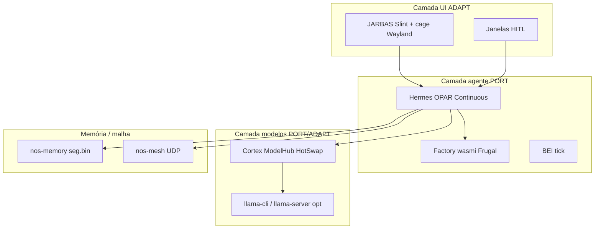

# Arquitectura — NixAIOS 0.6.0-alpha.3

## Posicionamento

NixAIOS é um **produto paralelo** ao bare-metal `neural-os-core`: mesma doutrina cognitiva, substrato **Linux + NixOS + systemd**, não um fork do Ring0.

## Persona e fluxo

1. **JARBAS** — cerimónia / HUD / HITL (não painel sysadmin).
2. **Hermes** — Observe → Plan → Act → Verify → Remember (OPAR).
3. **Cortex** — slots GGUF, rota S1/S2, HotSwap, capacity.

## Camadas de portabilidade (ADR-0118)

| Camada | O quê | Exemplos |
|--------|--------|----------|
| **PORT** | Lógica `std` / agentes | CapGate, wasmi, mesh wire, nsgdb facade, hub |
| **ADAPT** | UI/áudio/GPU via Linux | cage DRM, PipeWire, HF fetch, llama |
| **DELEGATE** | Kernel/systemd | boot, NIC, NVMe, cgroup |

Detalhe: [`adr-addenda/0118-portability-layers.md`](adr-addenda/0118-portability-layers.md).

## Workspace Rust (`packages/nosd`)

| Crate | Papel |
|-------|--------|
| `nosd` | Daemon Tokio, IPC, transmute, Landlock, actuators |
| `nos-core` | CapGate, score, policy, UI window types |
| `nos-hermes` | Agente OPAR, blob_deliberate, cards, SelfHeal stub |
| `nos-cortex` | ModelHub, HotSwap, fetch HF, capacity, router |
| `nos-factory` | Seek, PackageStore, spawn WASM path A |
| `nos-wasm` | wasmi Frugal 256 KiB / fuel 100k |
| `nos-memory` | nsgdb `seg.bin` L2/L3 (JSONL opt-in) |
| `nos-mesh` | HB, FRAG/FRACK, CRDT thin, SoulMirror |
| `nos-jarbas` | HUD Slint / hub |
| `nos-bei` | Budget / affect / sleep tick |
| `nos-voice` | Whisper/Piper paths (EngineAbsent sem bins) |
| `nos-observe` | journal/NM/sysfs → EventBus |
| `nos-bus` | EventBus + LatentBus |
| `nos-ipc` | Framing Request/Response |

## Módulos NixOS (`modules/`)

| Módulo | Função |
|--------|--------|
| `neural-os.nix` | unit `nosd`, user, tmpfiles, ProtectSystem |
| `jarbas-cage.nix` | Wayland cage tty7, iGPU |
| `transmute-stage.nix` | firstboot texto Q1–Q5 → transmute → hotswap |
| `ai-managed.nix` / `cortex-nix-ring.nix` | propose/apply HITL |
| `nosd-early.nix` | BOOT SCORE pré-getty |
| `nosd-engine.nix` | dGPU cgroup separado do cage |
| `log-fat32.nix` | FAT NIXAIOSLOG (default **OFF** na ISO 0.5.0) |

## Persistência 0.5.x

- Default: `/var/lib/nosd` (models, nsgdb, firstboot, hotswap).
- FAT `/mnt/nixaios-log` só com `NIXAIOS_USE_FAT_PERSIST=1` + mount gravável.
- Live ISO: estado volátil entre reboots até instalação/overlay.
- **Permissões ISO:** `tmpfiles`/`activation` usam `1777` em `/var/lib/nosd` (override `mkAfter` sobre `0750` de `neural-os.nix`) para firstboot+nosd na live — intencional.

## Anti-claims

- BitNet/Falcon3 ternário **não** roda nativo no `nosd` (HotSwap GGUF ≠ Cortex bare).
- wasmtime **não** é path A (wasmi Frugal).
- X11 **proibido** no kiosk (Wayland+cage).
- ISO build PASS ≠ metal PASS.
