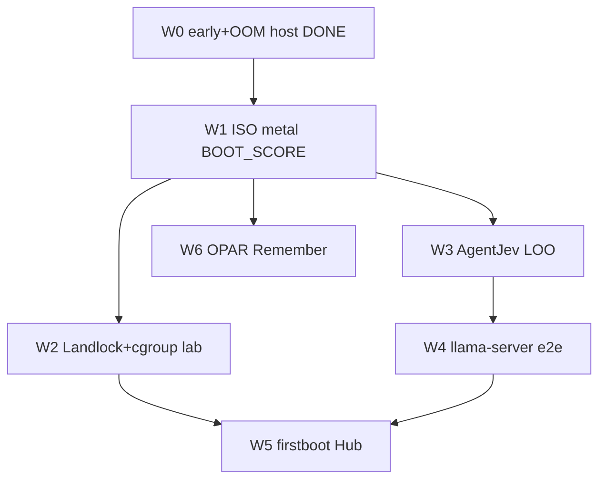

# Plano de implementação — Master Prompt Unification (triagem)

**Fonte:** [`MASTER_PROMPT_UNIFICATION_TRIAGE.md`](MASTER_PROMPT_UNIFICATION_TRIAGE.md)  
**Ledger:** [`REMIGRATION_PLAN_LEDGER.md`](REMIGRATION_PLAN_LEDGER.md)  
**Honestidade:** ADR-0113 — UI todo ≠ aceite; host VERIFIED ≠ metal VERIFIED.  
**Regra-mãe:** não reexecutar itens **DONE**; só fechar gaps **PARTIAL** / validação metal com evidência.

---

## 0. Estado após onda R0/B.1 (já aplicada)

| ID | Entrega | Evidência |
|----|---------|-----------|
| B.1↑ | `nosd-early`: observe + BOOT SCORE pré-getty | `modules/nosd-early.nix`; JSON `/var/lib/nosd/{observe-early,boot-score}.json` |
| — | `nosctl observe` → `observe.snapshot` | `nosctl.rs`; `cargo check -p nosd` OK |
| S1.2 | AgentJev na ISO = **REJECT** mantido | `NOSD_S1_BACKEND=keyword` no early |
| I.5↑ | engine OOM=+200/MemoryMax; cage OOM=-500 | `nosd-engine.nix` / `jarbas-cage.nix` |
| I.3 thin | ProtectHome+DeviceAllow; **sem** ProtectSystem=strict | triage REJECT DRM |

**Aceite onda 0 (host):** ✅ código + check.  
**Aceite onda 0 (metal):** ⏳ rebuild ISO + grep journal `BOOT_SCORE` / `observe.snapshot OK` no firstboot.

---

## 1. Escopo do plano (o que entra / sai)

### ENTRA (viável, ordem de dependência)

1. **Validação metal early-boot** (fecha B.1 como DONE host+metal parcial).  
2. **I.3 metal** — Landlock syscall no `nosd` sob kernel Linux (lab).  
3. **I.5 e2e** — prova cgroup: OOM no engine não derruba cage.  
4. **NX.3 residual** — DBus NetworkManager (opcional thin) se early observe ficar cego sem `nmcli`.  
5. **S1.1 / P.3** — AgentJev via `blob_deliberate` LOO (runtime, nunca ISO).  
6. **S2.2** — `llama-server` persistente e2e + cancel.  
7. **P.13 / B.1** — Hub triage + firstboot Slint residual (só se metal early OK).  
8. **DB.2** — OPAR Remember/Recall nos loops SelfHeal/mesh que ainda faltam.

### SAI (REJECT / DEFER — não implementar neste plano)

| Item | Motivo |
|------|--------|
| AgentJev/Piper seed ISO + mmap &lt;100ms sysinit | **S1.2 REJECT** |
| ProtectSystem=strict no cage | quebra seatd/DRM |
| Orb 3 Z-order DRM + LatentBus f16[256] nativo | **DEFER** P.2/J.2 (Slint ≠ bare compositor) |
| CRDT mesh merge pleno / nsgdb L5–L7 | **DEFER** M.2/DB.1 (onda mesh dedicada) |
| Clone/compile neural-os no boot | **REJECT** |
| Reescrever flake do zero | **REJECT** |
| build-vm e2e metal como gate desta unificação | residual NX.1 — onda NX aparte |

---

## 2. Ondas de implementação

```
W0 [DONE host]  R0/B.1 harden early + OOM split
     │
     ▼
W1  Metal prove early-boot + ISO rebuild
     │
     ▼
W2  Isolamento I.3/I.5 lab (Landlock + cgroup e2e)
     │
     ▼
W3  S1 LOO AgentJev (blob_deliberate) — pós-HITL, fora do sysinit
     │
     ▼
W4  S2 llama-server e2e + score pós-infer
     │
     ▼
W5  Firstboot Slint + Hub score triage (B.1 / P.13 residual)
     │
     ▼
W6  OPAR Remember universal thin (DB.2) — só se W1–W2 verdes
```

Mesh CRDT (M.2) e Orb (P.2) **não** entram nas ondas W1–W6; ficam no backlog ledger.

---

### W1 — Prova metal early-boot (B.1 → DONE↑)

**Goal:** no firstboot da ISO, antes do getty, journal mostra observe + BOOT SCORE.

| # | Tarefa | Artefato | Aceite |
|---|--------|----------|--------|
| 1.1 | Rebuild ISO/IMG (`scripts/build-iso.sh`) | `Downloads/nixaios-minimal-051*.{iso,img}` + sha256 | build exit 0 |
| 1.2 | Boot metal/QEMU NixAIOS | journal `nosd-early-score` | `observe.snapshot OK` + `BOOT_SCORE …` |
| 1.3 | Confirmar mirror FAT se montado | `/mnt/nixaios-log/{observe-early,boot-score}.json` | ficheiros não vazios **ou** slog honesto “FAT absent” |
| 1.4 | Atualizar ledger B.1 | `REMIGRATION_PLAN_LEDGER.md` | PARTIAL↑ → **DONE** (host+metal) **ou** manter PARTIAL com log gap |

**Falsificador:** early falha silenciosa (sem linha journal) = NÃO marcar DONE.

---

### W2 — Isolamento lab (I.3 / I.5)

**Goal:** falha de inferência/VRAM no engine não mata cage; Landlock no nosd é **Observed** no Linux.

| # | Tarefa | Artefato | Aceite |
|---|--------|----------|--------|
| 2.1 | Documentar/ativar `try_restrict_process` no path boot nosd (Linux) | `landlock.rs` + slog `Landlock=Verified|Absent` | 1 boot Linux com sev `ok`/`warn` honesto |
| 2.2 | Stress OOM no `nosd-engine@` (alloc hostil ou limiar baixo) | unit + script lab | cage vivo; engine OOM-kill; journal prova |
| 2.3 | DeviceAllow DRM: cage acessa `/dev/dri`; engine **sem** card se política split | modules | grep DeviceAllow + 1 run |
| 2.4 | Ledger I.3/I.5 | ledger | PARTIAL → DONE **só** com log lab; senão PARTIAL+evidência |

**Não fazer:** ProtectSystem=strict; PAMName no cage.

---

### W3 — System-1 LOO (S1.1 / P.3) — fora do early

**Goal:** keyword → AgentJev GGUF via fetch deliberado **após** HITL; early continua keyword.

| # | Tarefa | Artefato | Aceite |
|---|--------|----------|--------|
| 3.1 | Gate: `NOSD_S1_BACKEND=agentjev` só se blob validado + CapGate | hermes/cortex S1 | sem blob = keyword; com blob = score real |
| 3.2 | Wire `blob_deliberate` + transmute `--confirm` já existente | firstboot Q5 path | 1 fetch metal/QEMU com card HITL |
| 3.3 | Proibir qualquer `mkfat`/ISO seed do GGUF S1 | `iso.nix` + CI grep | grep AgentJev na ISO = 0 |
| 3.4 | Ledger S1.1/P.3 | ledger | PARTIAL→DONE host; metal = OBSERVED se 3.2 OK |

**Invariante:** early-boot **nunca** espera GGUF (timeout &lt; early oneshot).

---

### W4 — System-2 e2e (S2.2)

**Goal:** `NOSD_LLAMA_SERVER` sobe, stream+cancel, score pós-ato.

| # | Tarefa | Artefato | Aceite |
|---|--------|----------|--------|
| 4.1 | Unit/path `llama-server` + CapGate NET/FS | `LlamaServerBackend` | smoke host SSE |
| 4.2 | Cancel Drop + timeout | testes + 1 run | cancel não deixa zombie |
| 4.3 | `nosctl score` pós-infer reflecte posture | score JSON | campo engine ≠ mentira Ready sem bin |
| 4.4 | Ledger S2.2 | ledger | PARTIAL→DONE host; metal residual declarado |

AirLLM mmap real TooTight = residual P.5 (só se 4.1 verde).

---

### W5 — Firstboot UI + Hub (B.1 residual / P.13)

**Goal:** firstboot Slint + Hub Health lê BOOT SCORE early (não inventa métrica).

| # | Tarefa | Artefato | Aceite |
|---|--------|----------|--------|
| 5.1 | Cage sobe pós-early (`After=nosd-early-score`) | `jarbas-cage.nix` | ordem journal correta |
| 5.2 | Card Hub lê `/var/lib/nosd/boot-score.json` | nos-jarbas / IPC | `n/a ≠ 0` |
| 5.3 | Firstboot Q5→transmute `--confirm` regressão | transmute-stage | GUI sobe mesmo se download falhar (hotswap honesty) |
| 5.4 | Ledger B.1 firstboot + P.13 | ledger | gaps nomeados |

**DEFER:** Orb espectral 16 bins / SoulMirror cluster.

---

### W6 — OPAR Remember thin (DB.2)

**Goal:** loops SelfHeal/mesh que ainda skipam Remember passam a gravar L2/L3 seg.bin.

| # | Tarefa | Artefato | Aceite |
|---|--------|----------|--------|
| 6.1 | Inventário callers sem `opar_after_ok` | grep + lista | lista no SESSION |
| 6.2 | Wire Remember nos 2–3 hot paths prioritários | nos-hermes / mesh tick | teste host |
| 6.3 | Ledger DB.2 | ledger | PARTIAL→DONE **só** se inventário zerado nos paths listados |

---

## 3. Dependências entre ondas



- W3 **não** bloqueia W1 (LOO é pós-login/HITL).  
- W4 pode correr em paralelo a W2 se GPU lab disponível.  
- W5 exige W1 (score ficheiro) + preferência W2 (cage estável).

---

## 4. Critérios globais de fecho do plano

Plano Master Unification = **FECHADO** quando:

1. B.1 metal: journal early BOOT_SCORE (W1).  
2. I.5: evidência OOM split (W2) **ou** PARTIAL explícito com motivo.  
3. S1.2 REJECT intacto (grep ISO).  
4. Ledger atualizado; SESSION_NNN com hashes ISO se rebuild.  
5. Nenhum item DEFER/REJECT marcado DONE.

**Não** exige para fecho: CRDT, Orb f16, AgentJev no sysinit, build-vm metal.

---

## 5. Checklist operacional (por onda)

- [ ] Código na crate/módulo certo (não engordar monólito bare).  
- [ ] `cargo check -p nosd` (ou crate tocada) exit 0.  
- [ ] Teste host **ou** log runtime colado na SESSION.  
- [ ] Linha ledger status + evidência.  
- [ ] TECNOLOGIAS_NIXAIOS N.3* se tecnologia nova.  
- [ ] Sem seed de blob na ISO.

---

## 6. Estado de execução (2026-10-25)

| Onda | Código host | Aceite |
|------|-------------|--------|
| W0 | DONE | host ✅ |
| W1–W6 | **implementado** (wiring + honesty + scripts) | host VERIFIED (check+test); metal / ISO journal **AWAITING** rebuild+boot |
| Fecho plano | — | exige W1 metal `BOOT_SCORE` no journal |

Backlog paralelo (fora deste plano): M.2 CRDT, M.3 lab 2-nó, P.2 Orb — ver ledger.

---

## Referências

- Triagem: `nixaios/docs/MASTER_PROMPT_UNIFICATION_TRIAGE.md`  
- Ledger: `nixaios/docs/REMIGRATION_PLAN_LEDGER.md`  
- Early: `nixaios/modules/nosd-early.nix`  
- SESSION: `docs/memory/SESSION_529.md`  
- ADR-0118 / ADR-0113
